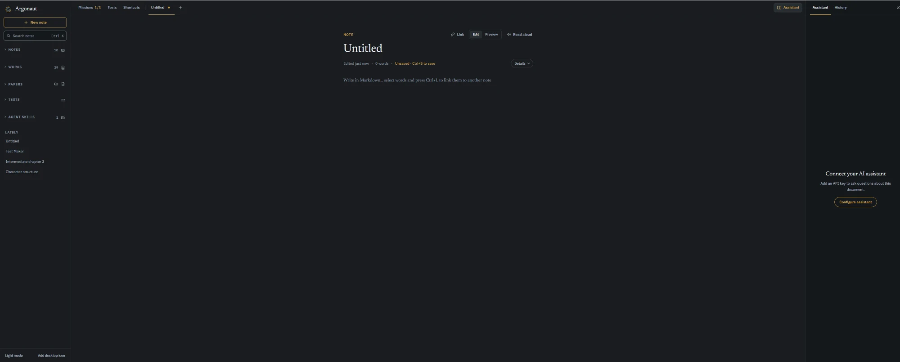
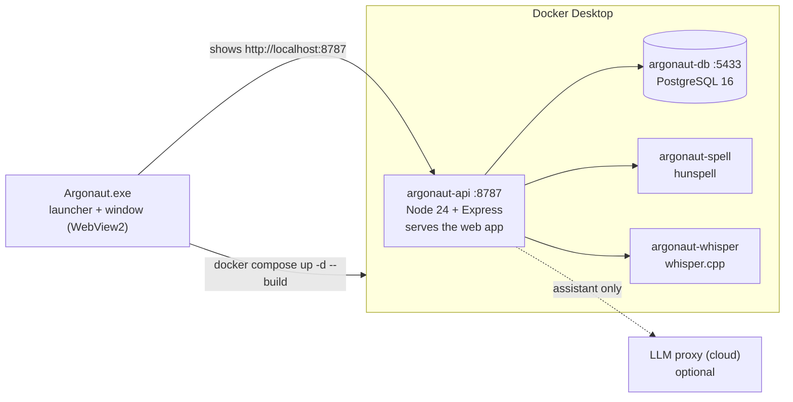

# Argonaut



A voice-first knowledge vault for Windows: notes in Markdown with `[[wikilinks]]`, books
written a page at a time, PDF papers, self-tests with scores and weekly missions, daily
tasks, and an AI assistant you can talk to. It runs on your own PC, in its own window, with
your data in a local PostgreSQL database.

- **Notes and works**: Markdown notes in groups, linked with `[[wikilinks]]`, with images,
  spell checking (English, Portuguese, French, Spanish), find and replace, and books whose
  pages join into one final view you can export.
- **Papers**: PDFs filed in folders, with their title, authors, year and DOI read from the file.
- **Tests**: import tests as JSON or have the assistant write one from your notes; scores are
  kept, and each imported batch becomes a weekly mission.
- **Missions**: daily, weekly, monthly and yearly tasks with subtasks and streaks.
- **Assistant**: ask by voice or keyboard; it can tick and change tasks for you, and reads its
  answers aloud. Speech is turned into text on your PC by whisper.cpp.
- **Agent Skills**: instructions for AI agents, kept as notes. The **Test Maker** skill tells
  any agent how to write an Argonaut test about a topic you give it.

The complete manual, covering every feature, shortcut, design decision and API route, is in
[documentation/README.md](documentation/README.md).

## How it fits together



| Part | What it is |
|---|---|
| `src/`, `shared/` | The web app: React 18, TypeScript, Vite |
| `server/` | The API and web server: Node 24, Express, `pg`; schema changes in `server/migrations/` |
| `spell/` | The spell-check service (hunspell dictionaries) |
| `whisper/` | The speech-recognition service: whisper.cpp v1.9.5 with the multilingual `base` model |
| `launcher/` | `Argonaut.exe`: starts Docker and the containers, then shows the app in a WebView2 window |
| `database/` | The schema as one SQL file, and scripts to install it on your own PostgreSQL |
| `scripts/` | The installer |
| `docker-compose.yml` | The four containers, bound to this PC only (127.0.0.1 and ::1) |

The ports are only reachable from the PC itself: the API has no sign-in, so it must never be
exposed to a network.

## Requirements

- Windows 10 or 11, 64-bit
- [Docker Desktop](https://www.docker.com/products/docker-desktop/) with the WSL 2 backend
- The Microsoft Edge WebView2 Runtime (it comes with Windows updates)
- .NET Framework 4.8 (it ships with Windows), used to compile `Argonaut.exe`
- About 3 GB of disk for the images; the first build needs an internet connection
- Optional: an API key for an OpenAI-compatible LLM proxy, for the assistant. Everything else
  works without one.

Node.js is only needed for development: the containers build the app themselves.

## Install

```powershell
git clone <this repository> argonaut
cd argonaut
powershell -ExecutionPolicy Bypass -File scripts\install.ps1
```

The installer:

1. Checks for .NET Framework, the WebView2 Runtime and Docker Desktop, and offers to install
   whatever is missing with `winget`. It updates WSL and starts Docker Desktop if they're down.
2. Writes `.env` from `.env.example`. It asks for the assistant's key (Enter skips it) and,
   for a new database, sets a random `POSTGRES_PASSWORD`. An existing `.env` is kept.
3. Builds and starts the four containers with `docker compose up -d --build`. The first build
   takes several minutes, because it compiles whisper.cpp and downloads its 148 MB model,
   which is checked against its published SHA-1.
4. Waits until `http://localhost:8787/api/health` answers.
5. Builds `Argonaut.exe` with `launcher\build.ps1`. That fetches the WebView2 SDK
   (1.0.4314.35) from nuget.org once, checks that its DLLs are signed by Microsoft, and places
   them beside the exe.
6. Puts an **Argonaut** shortcut on the desktop. (Without one, the app offers **Add desktop
   icon** at the foot of its sidebar.)

Options: `-LlmApiKey <key>`, `-WithStarterTasks` (three example tasks in Missions), and
`-NoShortcut`. The script is safe to run again.

From then on, start Argonaut from the shortcut. Every launch wakes Docker if needed, runs
`docker compose up -d --build` (which rebuilds only what changed), waits for the API, and
opens the window. `Argonaut.exe --stop` stops the containers.

## The database

**With Docker, there's nothing to do.** The `argonaut-db` container creates the `argonaut`
database and user the first time, and the API brings the schema up to date every time it
starts. It applies each file in `server/migrations/` once, in order, and records it in
`schema_migrations`. The data lives in the `argonaut-db-data` Docker volume.

**From scratch, on a PostgreSQL you run yourself** (version 16 or newer):

| File | What it does |
|---|---|
| [database/create-role-and-database.sql](database/create-role-and-database.sql) | Creates the login role and its database (UTF-8, owned by that role). Run it as a superuser; it does nothing if they already exist |
| [database/schema.sql](database/schema.sql) | The whole schema: every table, index, constraint and trigger, plus the `schema_migrations` rows, so the API finds nothing left to migrate |
| [server/seeds/starter-tasks.sql](server/seeds/starter-tasks.sql) | Optional example tasks |
| [database/install-database.ps1](database/install-database.ps1) | Runs all of the above with `psql` |

```powershell
.\database\install-database.ps1 -DbHost localhost -Port 5432 -AdminUser postgres -WithStarterTasks
```

It asks for the new role's password (and psql asks for the admin's). Defaults: database and
role `argonaut`. Or do the same by hand:

```powershell
psql -h localhost -U postgres -d postgres -v ON_ERROR_STOP=1 `
     -v app_user=argonaut -v app_db=argonaut -v app_password='a long secret' `
     -f database/create-role-and-database.sql
psql -h localhost -U argonaut -d argonaut -v ON_ERROR_STOP=1 -f database/schema.sql
```

Then run the API against it, outside Docker:

```powershell
npm ci; npm run build                         # the web app, into dist\
cd server; npm ci; npm run build              # the API, into server\dist\
Copy-Item -Recurse ..\dist dist\server\public # the API serves the web app from here
$env:PGHOST='localhost'; $env:PGPORT='5432'; $env:PGDATABASE='argonaut'
$env:PGUSER='argonaut'; $env:PGPASSWORD='a long secret'
node dist\server\src\index.js                 # http://localhost:8787
```

Spell checking and speech recognition come from their containers
(`docker compose up -d argonaut-spell argonaut-whisper`, reached through `SPELL_URL` and
`WHISPER_URL`). Without them those features say they're unavailable, and the rest of the app
works.

`database/schema.sql` is generated from the migrations; don't edit it by hand. After adding a
migration, regenerate it with the database container running:

```powershell
.\database\generate-schema.ps1
```

The API tests include one (`server/test/schema-file.test.mjs`) that fails whenever
`schema.sql` and the migrations disagree.

## Configuration

`.env` in the project folder (copied from `.env.example`). It holds your key, so it is never
committed.

| Setting | Meaning |
|---|---|
| `LLM_BASE_URL`, `LLM_API_KEY`, `LLM_MODEL` | The assistant's OpenAI-compatible endpoint, key and model. Server-side only |
| `SETTINGS_FILE` | The full path of `.env`, shown by the app's **Configure assistant** steps |
| `POSTGRES_PASSWORD` | The database password, read only when the database is first created (default `argonaut`) |
| `VITE_API_BASE_URL` | Development only: where the Vite dev server finds the API |

## Everyday commands

```powershell
.\Argonaut.exe                       # start everything and open the window
.\Argonaut.exe --stop                # stop the containers
docker compose ps                    # what's running
docker compose logs -f argonaut-api  # the API's log

# Back up the database to argonaut-backup.dump
docker exec argonaut-db pg_dump -U argonaut -Fc -f /tmp/argonaut.dump argonaut
docker cp argonaut-db:/tmp/argonaut.dump .\argonaut-backup.dump

# Restore it, replacing what's in the database
docker compose stop argonaut-api
docker cp .\argonaut-backup.dump argonaut-db:/tmp/argonaut.dump
docker exec argonaut-db pg_restore -U argonaut -d argonaut --clean --if-exists /tmp/argonaut.dump
docker compose start argonaut-api
```

Everything you write lives in the `argonaut-db-data` volume. It survives rebuilds, but not
`docker compose down -v` or a Docker Desktop reset, so keep backups somewhere else.

## Development

Needs Node.js 24.

```powershell
npm install; npm --prefix server install; npm --prefix spell install
npm run dev          # the web app with hot reload on http://localhost:5173 (API container running)
npm run check        # lint, type checks and unit tests
npm run test:api     # API tests, each on a throwaway database it creates and drops
npm run test:spell   # spell-checker tests
```

The API tests need the database container (`docker compose up -d argonaut-db`), and never
touch the real `argonaut` database.

## Privacy

- Notes, papers, tasks and tests stay in the local database.
- Speech is transcribed on your PC by `argonaut-whisper`. Recordings and their text are held in
  memory only while they're processed, and are never stored or logged.
- Only the assistant leaves the PC: your question, recent conversation and the task list go to
  the LLM endpoint in `.env`, if you configure one.
- Read-aloud uses the voices Windows offers to the window.

## License

No license has been chosen yet, so all rights are reserved until one is added.
